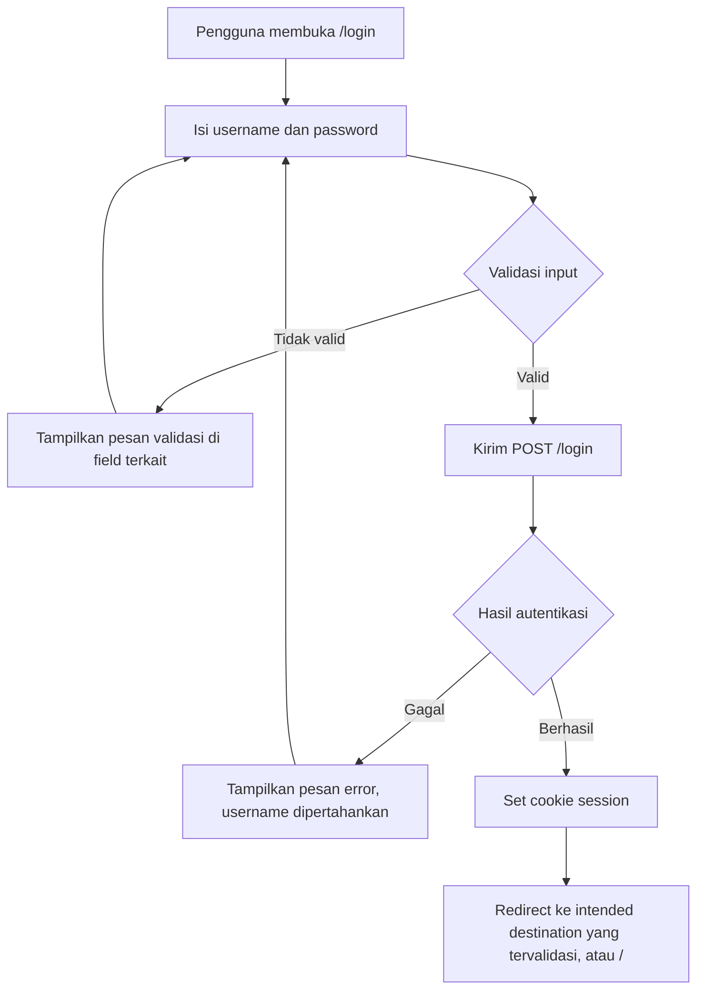
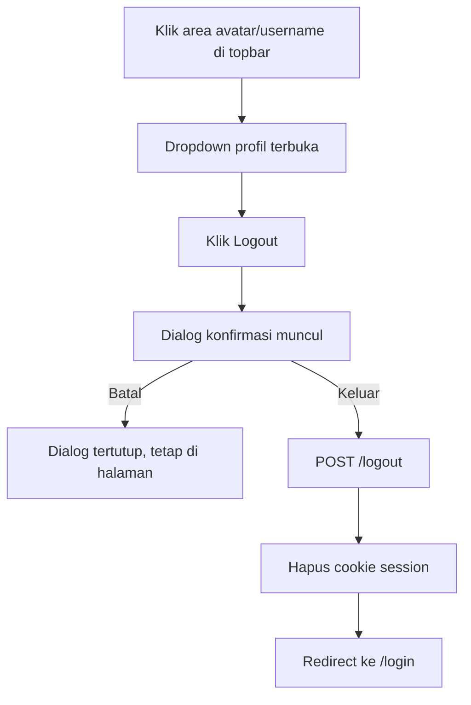

# Authentication Flow

## Tujuan

Mendokumentasikan perjalanan pengguna terkait login dan logout. Registrasi dan pemulihan akun berada di luar scope — akun dibuat manual oleh vendor.

## Login Flow

## Logout Flow

## Related Pages

- [Login](../pages/account/login-page.md)
- [App Layout](../pages/app-layout.md)

## Open Decisions

- Tidak ada open decisions.
