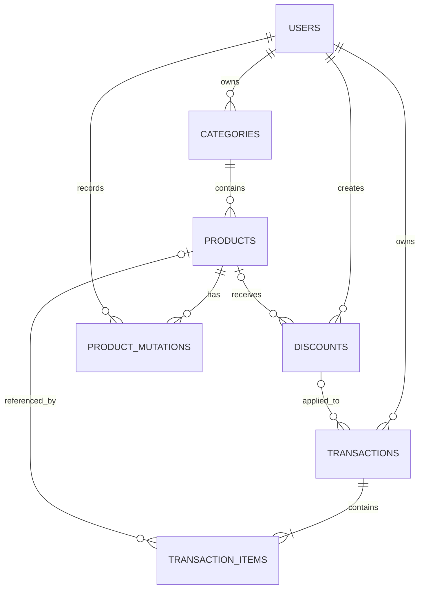

# Database Design — POS System

## 1. Overview

Database ini dirancang untuk aplikasi Point of Sale (POS) yang mendukung pengelolaan pengguna, kategori, produk, diskon, transaksi penjualan, dan mutasi stok.

### Database Tables

1. `users`
2. `categories`
3. `products`
4. `discounts`
5. `transactions`
6. `transaction_items`
7. `product_mutations`

### General Conventions

- Primary key menggunakan UUID.
- Semua tabel menggunakan `created_at` dan `updated_at` jika diperlukan.
- Soft delete menggunakan `deleted_at` pada tabel yang mendukung penghapusan.
- Nominal uang menggunakan `DECIMAL(15,2)`.
- Stok dan kuantitas menggunakan `DECIMAL(15,2)` untuk mendukung satuan pecahan.
- Semua nominal menggunakan mata uang Rupiah (IDR).

---

## 2. Entity Relationship Diagram



---

## 3. Table Definitions

### 3.1. Users

Menyimpan informasi akun pengguna.

| Column     | Data Type    | Constraint       | Description            |
| ---------- | ------------ | ---------------- | ---------------------- |
| id         | UUID         | PK               | Unique user identifier |
| username   | VARCHAR(100) | UNIQUE, NOT NULL | Username pengguna      |
| password   | VARCHAR(255) | NOT NULL         | Hashed password        |
| created_at | TIMESTAMP    | NOT NULL         | Waktu pembuatan        |
| updated_at | TIMESTAMP    | NOT NULL         | Waktu pembaruan        |
| deleted_at | TIMESTAMP    | NULL             | Waktu penghapusan      |

**Relationships:**

- One user has many categories.
- One user has many discounts.
- One user has many transactions.
- One user has many product mutations.

### 3.2. Categories

Menyimpan kategori produk milik pengguna.

| Column     | Data Type    | Constraint              | Description                |
| ---------- | ------------ | ----------------------- | -------------------------- |
| id         | UUID         | PK                      | Unique category identifier |
| user_id    | UUID         | FK → users.id, NOT NULL | Pemilik kategori           |
| name       | VARCHAR(100) | NOT NULL                | Nama kategori              |
| created_at | TIMESTAMP    | NOT NULL                | Waktu pembuatan            |
| updated_at | TIMESTAMP    | NOT NULL                | Waktu pembaruan            |
| deleted_at | TIMESTAMP    | NULL                    | Waktu penghapusan          |

**Constraints:**

- Nama kategori harus unik untuk setiap user.
- Perbandingan nama bersifat case-insensitive.
- Contoh: `Makanan`, `makanan`, dan `MAKANAN` dianggap sama.
- Unique constraint perlu mempertimbangkan soft-deleted records agar nama kategori dapat digunakan kembali setelah kategori lama dihapus.

**Relationships:**

- Belongs to one user.
- One category has many products.

### 3.3. Products

Menyimpan informasi produk dan stok.

| Column      | Data Type     | Constraint                   | Description               |
| ----------- | ------------- | ---------------------------- | ------------------------- |
| id          | UUID          | PK                           | Unique product identifier |
| category_id | UUID          | FK → categories.id, NOT NULL | Kategori produk           |
| name        | VARCHAR(150)  | NOT NULL                     | Nama produk               |
| image       | VARCHAR(255)  | NULL                         | Lokasi file gambar        |
| price       | DECIMAL(15,2) | NOT NULL                     | Harga jual                |
| stock       | DECIMAL(15,2) | NOT NULL                     | Jumlah stok               |
| unit        | VARCHAR(30)   | NOT NULL                     | Satuan produk             |
| created_at  | TIMESTAMP     | NOT NULL                     | Waktu pembuatan           |
| updated_at  | TIMESTAMP     | NOT NULL                     | Waktu pembaruan           |
| deleted_at  | TIMESTAMP     | NULL                         | Waktu penghapusan         |

**Constraints:**

- Tidak menggunakan `user_id`.
- Kepemilikan produk ditentukan melalui relasi `category_id` → `categories.user_id`.
- Harga tidak boleh negatif.
- Stok tidak boleh negatif.
- Gambar menyimpan path atau lokasi file, bukan binary gambar.
- Kategori produk harus dimiliki oleh user yang sedang login.

**Example Units:**

- `pcs`
- `kg`
- `gram`
- `liter`
- `box`
- `pack`

**Relationships:**

- Belongs to one category.
- One product can have many product mutations.
- One product can have many transaction items.
- One product can have discount configurations.

### 3.4. Discounts

Menyimpan konfigurasi Product Discount dan Transaction Discount dalam satu tabel.

| Column                 | Data Type     | Constraint              | Description                |
| ---------------------- | ------------- | ----------------------- | -------------------------- |
| id                     | UUID          | PK                      | Unique discount identifier |
| user_id                | UUID          | FK → users.id, NOT NULL | Pemilik diskon             |
| product_id             | UUID          | FK → products.id, NULL  | Produk terkait             |
| name                   | VARCHAR(150)  | NOT NULL                | Nama diskon                |
| discount_scope         | VARCHAR(20)   | NOT NULL                | Jenis cakupan diskon       |
| discount_type          | VARCHAR(20)   | NOT NULL                | Jenis perhitungan diskon   |
| discount_value         | DECIMAL(15,2) | NOT NULL                | Nilai diskon               |
| min_transaction_amount | DECIMAL(15,2) | NULL                    | Minimal nominal transaksi  |
| starts_at              | TIMESTAMP     | NULL                    | Waktu mulai diskon         |
| ends_at                | TIMESTAMP     | NULL                    | Waktu berakhir diskon      |
| is_active              | BOOLEAN       | NOT NULL                | Status aktif               |
| created_at             | TIMESTAMP     | NOT NULL                | Waktu pembuatan            |
| updated_at             | TIMESTAMP     | NOT NULL                | Waktu pembaruan            |
| deleted_at             | TIMESTAMP     | NULL                    | Waktu penghapusan          |

#### Discount Scope

Menentukan cakupan diskon.

| Value         | Description                  |
| ------------- | ---------------------------- |
| `product`     | Diskon khusus produk         |
| `transaction` | Diskon keseluruhan transaksi |

#### Discount Type

Menentukan cara menghitung diskon.

| Value        | Description          |
| ------------ | -------------------- |
| `percentage` | Diskon persentase    |
| `fixed`      | Diskon nominal tetap |

#### Discount Rules

**Product Discount:**

- `discount_scope` bernilai `product`.
- `product_id` wajib diisi.
- `min_transaction_amount` harus NULL.
- Diskon hanya berlaku pada produk yang ditentukan.

**Transaction Discount:**

- `discount_scope` bernilai `transaction`.
- `product_id` harus NULL.
- `min_transaction_amount` dapat digunakan untuk menentukan minimal nominal transaksi.
- Diskon diterapkan pada keseluruhan transaksi.

#### Example Data

| name              | discount_scope | discount_type | discount_value | min_transaction_amount |
| ----------------- | -------------- | ------------- | -------------: | ---------------------: |
| Diskon Indomie    | product        | percentage    |             10 |                   NULL |
| Promo Hemat       | transaction    | fixed         |           5000 |                 100000 |
| Promo Akhir Bulan | transaction    | percentage    |             15 |                 200000 |

#### Additional Constraints

- `discount_value` harus lebih besar dari nol.
- Persentase diskon tidak boleh melebihi 100.
- `ends_at` tidak boleh lebih awal dari `starts_at`.
- Diskon harus dimiliki oleh user yang sama dengan produk terkait.
- Untuk versi awal, direkomendasikan satu Product Discount aktif per produk.

### 3.5. Transactions

Menyimpan informasi utama transaksi penjualan.

| Column                      | Data Type     | Constraint              | Description                         |
| --------------------------- | ------------- | ----------------------- | ----------------------------------- |
| id                          | UUID          | PK                      | Unique transaction identifier       |
| user_id                     | UUID          | FK → users.id, NOT NULL | Pemilik transaksi                   |
| discount_id                 | UUID          | FK → discounts.id, NULL | Transaction Discount yang digunakan |
| transaction_number          | VARCHAR(50)   | UNIQUE, NOT NULL        | Nomor transaksi                     |
| subtotal                    | DECIMAL(15,2) | NOT NULL                | Subtotal sebelum diskon produk      |
| product_discount_total      | DECIMAL(15,2) | NOT NULL                | Total diskon produk                 |
| transaction_discount_amount | DECIMAL(15,2) | NOT NULL                | Nominal diskon transaksi            |
| total                       | DECIMAL(15,2) | NOT NULL                | Total pembayaran                    |
| cash_received               | DECIMAL(15,2) | NOT NULL                | Uang diterima                       |
| change_amount               | DECIMAL(15,2) | NOT NULL                | Uang kembalian                      |
| created_at                  | TIMESTAMP     | NOT NULL                | Waktu transaksi                     |
| updated_at                  | TIMESTAMP     | NOT NULL                | Waktu pembaruan                     |

**Business Rules:**

- Semua transaksi menggunakan pembayaran tunai.
- `discount_id` hanya mengacu pada Transaction Discount.
- Jika tidak menggunakan Transaction Discount, `discount_id` bernilai NULL.
- `subtotal` dihitung sebelum diskon produk.
- `total` dihitung setelah seluruh diskon.
- `change_amount` = `cash_received` - `total`.
- Transaksi tidak boleh memiliki total negatif.
- Nomor transaksi harus unik.

### 3.6. Transaction Items

Menyimpan detail produk dalam suatu transaksi.

| Column          | Data Type     | Constraint                     | Description                        |
| --------------- | ------------- | ------------------------------ | ---------------------------------- |
| id              | UUID          | PK                             | Unique transaction item identifier |
| transaction_id  | UUID          | FK → transactions.id, NOT NULL | Transaksi terkait                  |
| product_id      | UUID          | FK → products.id, NULL         | Produk terkait                     |
| product_name    | VARCHAR(150)  | NOT NULL                       | Snapshot nama produk               |
| unit_price      | DECIMAL(15,2) | NOT NULL                       | Snapshot harga satuan              |
| quantity        | DECIMAL(15,2) | NOT NULL                       | Jumlah produk                      |
| discount_type   | VARCHAR(20)   | NULL                           | Jenis diskon produk                |
| discount_value  | DECIMAL(15,2) | NULL                           | Nilai diskon produk                |
| discount_amount | DECIMAL(15,2) | NOT NULL                       | Nominal diskon produk              |
| subtotal        | DECIMAL(15,2) | NOT NULL                       | Subtotal item setelah diskon       |
| created_at      | TIMESTAMP     | NOT NULL                       | Waktu pembuatan                    |

**Snapshot Rules:**

- `product_name` menyimpan nama produk saat transaksi dibuat.
- `unit_price` menyimpan harga produk saat transaksi dibuat.
- `discount_type` dan `discount_value` menyimpan konfigurasi diskon saat transaksi dibuat.
- `discount_amount` menyimpan nominal diskon yang benar-benar diterapkan.
- `product_id` boleh NULL jika produk sudah dihapus dan relasi menggunakan `ON DELETE SET NULL`.

**Business Rules:**

- Kuantitas harus lebih besar dari nol.
- Diskon produk diterapkan sebelum Transaction Discount.
- Subtotal item = (unit_price × quantity) − discount_amount.

### 3.7. Product Mutations

Mencatat seluruh perubahan stok produk.

| Column        | Data Type     | Constraint                 | Description                  |
| ------------- | ------------- | -------------------------- | ---------------------------- |
| id            | UUID          | PK                         | Unique mutation identifier   |
| product_id    | UUID          | FK → products.id, NOT NULL | Produk terkait               |
| user_id       | UUID          | FK → users.id, NOT NULL    | Pemilik mutasi               |
| mutation_type | VARCHAR(30)   | NOT NULL                   | Jenis mutasi                 |
| quantity      | DECIMAL(15,2) | NOT NULL                   | Jumlah perubahan stok        |
| stock_before  | DECIMAL(15,2) | NOT NULL                   | Stok sebelum perubahan       |
| stock_after   | DECIMAL(15,2) | NOT NULL                   | Stok setelah perubahan       |
| notes         | TEXT          | NULL                       | Catatan mutasi               |
| reference_id  | UUID          | NULL                       | Referensi transaksi jika ada |
| created_at    | TIMESTAMP     | NOT NULL                   | Waktu mutasi                 |

#### Mutation Types

| Value        | Description                        |
| ------------ | ---------------------------------- |
| `in`         | Stok masuk                         |
| `out`        | Stok keluar                        |
| `adjustment` | Penyesuaian stok                   |
| `sale`       | Stok berkurang karena penjualan    |
| `return`     | Stok bertambah karena pengembalian |

**Business Rules:**

- Setiap perubahan stok harus tercatat.
- `stock_before` dan `stock_after` menyimpan kondisi stok sebelum dan sesudah mutasi.
- `quantity` menyimpan jumlah perubahan stok.
- Mutasi penjualan harus terhubung dengan transaksi terkait melalui `reference_id`.
- Perubahan stok dan pencatatan mutasi harus dilakukan dalam satu database transaction.

---

## 4. Discount Calculation Flow

Diskon diterapkan dengan urutan berikut:

1. Hitung subtotal seluruh produk sebelum diskon.
2. Terapkan Product Discount pada item terkait.
3. Hitung subtotal setelah Product Discount.
4. Periksa syarat minimal Transaction Discount.
5. Terapkan Transaction Discount.
6. Hitung total pembayaran.

### Calculation Example

| Product |    Price | Quantity | Product Discount |
| ------- | -------: | -------: | ---------------: |
| Indomie |  Rp3.500 |       10 |              10% |
| Minyak  | Rp20.000 |        2 |              Rp0 |

| Calculation                     |   Amount |
| ------------------------------- | -------: |
| Subtotal                        | Rp75.000 |
| Product Discount                |  Rp3.500 |
| Subtotal After Product Discount | Rp71.500 |
| Transaction Discount            |  Rp5.000 |
| Total                           | Rp66.500 |

Contoh tersebut mengasumsikan minimal transaksi untuk Transaction Discount sudah terpenuhi.

### Formulas

```text
item_subtotal = unit_price * quantity

item_subtotal_after_discount =
    item_subtotal - discount_amount

subtotal = SUM(item_subtotal)

product_discount_total = SUM(discount_amount)

subtotal_after_product_discount =
    subtotal - product_discount_total

total =
    subtotal_after_product_discount - transaction_discount_amount

change_amount =
    cash_received - total
```

---

## 5. Database Integrity & Constraints

### Ownership Validation

- User hanya dapat mengakses kategori miliknya sendiri.
- User hanya dapat mengakses produk melalui kategori miliknya sendiri.
- User hanya dapat mengelola diskon miliknya sendiri.
- User hanya dapat mengakses transaksi miliknya sendiri.
- Semua relasi lintas tabel harus divalidasi pada backend.

### Soft Delete

Tabel berikut menggunakan `deleted_at`:

- `users`
- `categories`
- `products`
- `discounts`

Data transaksi dan mutasi stok sebaiknya dipertahankan sebagai riwayat dan tidak dihapus secara langsung.

### Transaction Integrity

Operasi berikut harus menggunakan database transaction:

- Membuat transaksi.
- Mengurangi stok produk.
- Membuat transaction items.
- Mencatat product mutations.
- Mengembalikan stok saat transaksi dibatalkan atau direfund, jika kebijakan tersebut diterapkan.

---

## 6. Open Decisions

Keputusan berikut belum ditentukan dan perlu diselesaikan sebelum implementasi final.

| Decision                                                 | Status | Notes                                            |
| -------------------------------------------------------- | ------ | ------------------------------------------------ |
| Gambar produk wajib atau opsional                        | Open   | Menentukan nullable atau NOT NULL                |
| Satu atau beberapa Product Discount aktif per produk     | Open   | Direkomendasikan satu untuk versi awal           |
| Dasar minimal Transaction Discount                       | Open   | Subtotal sebelum atau sesudah Product Discount   |
| Penghapusan kategori yang masih digunakan produk         | Open   | Tolak penghapusan atau minta kategori pengganti  |
| Penghapusan produk yang sudah memiliki riwayat transaksi | Open   | Relasi dan snapshot harus tetap aman             |
| Kebijakan refund dan pengembalian stok                   | Open   | Perlu aturan mutasi stok                         |
| Maksimal diskon transaksi                                | Open   | Mencegah diskon melebihi nominal yang seharusnya |
| Unique transaction number                                | Open   | Perlu strategi penomoran per user atau global    |

---

## 7. Final Table Summary

| Table               | Purpose                           |
| ------------------- | --------------------------------- |
| `users`             | User accounts                     |
| `categories`        | Product categories                |
| `products`          | Product information and stock     |
| `discounts`         | Product and transaction discounts |
| `transactions`      | Sales transactions                |
| `transaction_items` | Transaction product details       |
| `product_mutations` | Stock mutation history            |
